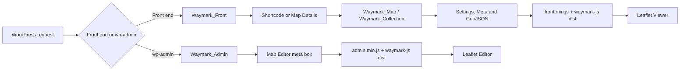

# Architecture

> How Waymark boots, stores data and gets a Map from WordPress to Leaflet.

## Bootstrap

[`Waymark.php`](../Waymark.php) is both the plugin header and the entry point. It requires the base classes, objects, helpers and the front and admin controllers, then:

- `Waymark_Install::init()` registers activation and uninstall hooks at file-load time.
- `Waymark_Config::init()` runs on `init` at priority -1, so settings and translations are available before post types and taxonomies register.
- `Waymark_Types`, `Waymark_Taxonomies`, `Waymark_Front` and `Waymark_Admin` are instantiated on `plugins_loaded`. Their constructors register hooks; the work itself is deferred to `init` or later.

The plugin version is the `Version` header in `Waymark.php`. [`Waymark_Config`](../inc/Waymark_Config.php) reads it with `get_file_data()` and exposes it through `Waymark_Config::get_version()`.

## `inc/` areas

| Area                                                          | Responsibility                                                                                                                                                                                     |
| ------------------------------------------------------------- | -------------------------------------------------------------------------------------------------------------------------------------------------------------------------------------------------- |
| [`inc/Waymark_Config.php`](../inc/Waymark_Config.php)         | Defaults, the stored settings overlay, getters, and the map config passed to JavaScript.                                                                                                           |
| [`inc/Waymark_Types.php`](../inc/Waymark_Types.php)           | Registers the `waymark_map` custom post type and its supports and rewrite settings.                                                                                                                |
| [`inc/Waymark_Taxonomies.php`](../inc/Waymark_Taxonomies.php) | Registers the hierarchical `waymark_collection` taxonomy on Maps.                                                                                                                                  |
| [`inc/Waymark_Install.php`](../inc/Waymark_Install.php)       | Activation, uninstall, upgrade checks, rewrite flushing and stable-key migration.                                                                                                                  |
| [`inc/Objects/`](../inc/Objects/)                             | [`Waymark_Object`](../inc/Objects/Waymark_Object.php) parameter and meta model; [`Waymark_Map`](../inc/Objects/Waymark_Map.php) and [`Waymark_Collection`](../inc/Objects/Waymark_Collection.php). |
| [`inc/Admin/`](../inc/Admin/)                                 | Menu, Settings screen, meta boxes, AJAX, revisions and admin asset helpers.                                                                                                                        |
| [`inc/Front/`](../inc/Front/)                                 | Shortcode, Map Details content, HTTP endpoint, submissions and front asset helpers.                                                                                                                |
| [`inc/Helpers/`](../inc/Helpers/)                             | Shared helpers, the form input builder and sanitiser, GeoJSON handling and JavaScript language strings.                                                                                            |

[`Waymark_Front`](../inc/Waymark_Front.php) returns immediately in wp-admin; [`Waymark_Admin`](../inc/Waymark_Admin.php) returns outside it. Each side loads its own `Waymark_JS` and `Waymark_CSS`, so only one of each is present per request.

## Data model

- **Maps** are `waymark_map` posts. The post title is the Map title; the overlay geometry is stored as GeoJSON in the `waymark_map_data` post meta.
- **Overlays** are GeoJSON features inside that FeatureCollection: Markers (`Point`), Lines (`LineString`) and Shapes (`Polygon` or a circular `Point`). Their appearance is selected with `properties.type`.
- **Types** are the Marker, Line and Shape definitions configured in Settings. Rows carry stable keys (`marker_key`, `line_key`, `shape_key`) used by shortcodes and CSS; legacy aliases are retained so older Maps keep working. Type labels are translated; keys are not.
- **Collections** are hierarchical `waymark_collection` taxonomy terms. A Map can belong to several Collections, and `Waymark_Collection` resolves a term and its Maps for rendering.
- **Map Meta** fields are defined in Settings and stored as `waymark_map_<key>` post meta. The same definitions drive the editor form, the Map Details page and shortcode output.

[`Waymark_Object`](../inc/Objects/Waymark_Object.php) maps post meta to parameter definitions, builds the edit form, sanitises values on save and handles duplication. [`Waymark_Map`](../inc/Objects/Waymark_Map.php) adds the `map_data` parameter and the configured Meta fields; [`Waymark_Collection`](../inc/Objects/Waymark_Collection.php) wraps the taxonomy term and its Maps.

## Settings, storage and upgrades

Settings are a single WordPress option, `Waymark_Settings`, registered by [`Waymark_Settings`](../inc/Admin/Waymark_Settings.php) on the `waymark-settings` admin page. Defaults live in [`Waymark_Config`](../inc/Waymark_Config.php); saved values are merged over them at bootstrap. The Settings screen is organised into tabs for Basemaps, Markers, Lines, Shapes, Meta, Properties, Submissions and Misc., and sanitises values on save.

There are no custom database tables. The persistent state is:

| Data             | Stored as                                              | Notes                                                                      |
| ---------------- | ------------------------------------------------------ | -------------------------------------------------------------------------- |
| Maps             | `waymark_map` posts                                    | The post title is the Map title; the post body is replaced at render time. |
| Collections      | `waymark_collection` terms                             | Hierarchical; a Map can belong to several.                                 |
| Overlay geometry | `waymark_map_data` post meta                           | A GeoJSON FeatureCollection.                                               |
| Map Meta         | `waymark_map_<key>` post meta                          | `<key>` is the stable Meta key, not the translated title.                  |
| Settings         | `Waymark_Settings` option                              | Merged over defaults at bootstrap.                                         |
| Version          | `Waymark_Version` option                               | Compared by `Waymark_Install::update_check()`.                             |
| Key migration    | `Waymark_Key_Aliases`, `Waymark_Key_Migration` options | Alias map and idempotence flag for stable keys.                            |
| Settings backup  | `Waymark_Settings_<old-version>` option                | Written when the version changes.                                          |

[`Waymark_Install::update_check()`](../inc/Waymark_Install.php) runs on `admin_init`. When the stored version differs from `Waymark_Config::get_version()`, it backs up the settings option, flushes rewrite rules and updates `Waymark_Version`. `migrate_i18n_keys()` runs on every admin load but is idempotent: it writes stable keys for Types, Meta fields and groups, records legacy aliases, and does not rewrite existing Map data. `do_uninstall()` deletes the current settings, the legacy settings backup, version and key-migration options; versioned `Waymark_Settings_<old-version>` backups remain. It does not delete Maps, Collections or Media Library items.

## Rendering a Map

1. A Map post is viewed directly, or a `[Waymark]` shortcode is rendered in any content.
2. [`Waymark_Content`](../inc/Front/Waymark_Content.php) replaces the Map post content with a shortcode and appends Meta on single Map pages.
3. [`Waymark_Shortcode`](../inc/Front/Waymark_Shortcode.php) loads the Map or Collection, builds the container, and emits per-instance options that extend the `waymark_user_config` object printed by `Waymark_JS`. `Waymark_Config::get_map_config()` supplies basemaps, Types, viewer and editor options, locale and type aliases.
4. [`Waymark_JS`](../inc/Front/Waymark_JS.php) enqueues `waymark-js` and `front.min.js`. The admin equivalent, [`inc/Admin/Waymark_JS.php`](../inc/Admin/Waymark_JS.php), handles the editor.
5. The browser-side `Waymark_Map_Factory` creates a Viewer or Editor from `waymark-js/dist`, which drives Leaflet.

### Shortcodes

- `[Waymark map_id="123"]` renders a single Map.
- `[Waymark collection_id="4"]` renders a Collection.
- `[Waymark content="submission"]` renders the front-end submission form.

Attributes fall into four groups:

- **View and layout:** `map_centre`, `map_zoom`, `max_zoom`, `map_height`, `map_width`, `map_hash`, `basemap`, `shortcode_header`.
- **Viewer controls:** `show_filter`, `show_gallery`, `show_cluster`, `show_elevation`, `elevation_units`.
- **Type visibility:** `show_marker`, `hide_marker`, `show_line`, `hide_line`, `show_shape`, `hide_shape`; values are comma-separated Type keys or `*`.
- **Inline Marker:** `marker_centre`, `marker_type`, `marker_title`, `marker_description`, `marker_image`.

The authoritative attribute handling is in [`inc/Front/Waymark_Shortcode.php`](../inc/Front/Waymark_Shortcode.php); the full user-facing table is [`help/content/index.md#shortcodes`](../help/content/index.md#shortcodes). Add or change an attribute in the handler, then update that table and the relevant test.

### Front-end requests and submissions

[`Waymark_HTTP`](../inc/Front/Waymark_HTTP.php) registers the `waymark_http` query var and handles the request on `template_redirect`. `Waymark_Helper::http_url()` builds the endpoint as `home_url('/?waymark_http=1')`. It serves Map data as GeoJSON for loading, or as GPX, KML or GeoJSON for export, with cache headers and nonce checks.

[`Waymark_Submission`](../inc/Front/Waymark_Submission.php) decides whether submissions are enabled, whether the current user is an administrator, a permitted role or a guest, which editor features are available, and the resulting post status. The shortcode renders the form; it posts to `waymark_http` with `public_add_map`, a nonce and the Map data. `create_map()` validates that the GeoJSON contains features, creates the `waymark_map` post, optionally assigns the configured default Collection, and redirects with the status. Public submissions default to `draft` and are moderated in the normal WordPress Maps list; registered-user submissions default to `publish`.

### Admin editing

[`Waymark_Meta`](../inc/Admin/Waymark_Meta.php) adds the Map Editor, Shortcode and Export meta boxes. The editor loads the Map's GeoJSON, the admin bundles and the `waymark-js` editor. Saving runs through `post_updated`, which builds a `Waymark_Map` from the request and calls `save_meta()`. [`Waymark_Revisions`](../inc/Admin/Waymark_Revisions.php) handles Map data revisions, and [`Waymark_AJAX`](../inc/Admin/Waymark_AJAX.php) serves the admin AJAX endpoints.

## HTTP and AJAX endpoints

Waymark does not register custom REST routes. Maps and Collections are registered with `show_in_rest`, so WordPress exposes them at the `rest_base` configured in Settings > Misc. > Permalinks ([`Waymark_Types`](../inc/Waymark_Types.php), [`Waymark_Taxonomies`](../inc/Waymark_Taxonomies.php)).

The plugin's own endpoints are:

| Surface      | Endpoint or action                        | Handler                                         | Notes                                                                                          |
| ------------ | ----------------------------------------- | ----------------------------------------------- | ---------------------------------------------------------------------------------------------- |
| Front end    | `?waymark_http=1` with `waymark_action`   | [`Waymark_HTTP`](../inc/Front/Waymark_HTTP.php) | `get_map_data`, `download_map_data`, `download_collection_data` and `public_add_map`.          |
| Admin AJAX   | `waymark_read_file`                       | [`Waymark_AJAX`](../inc/Admin/Waymark_AJAX.php) | Logged-in file import; the guest variant is `wp_ajax_nopriv_waymark_read_file`.                |
| Admin AJAX   | `waymark_get_attatchment_meta`            | [`Waymark_AJAX`](../inc/Admin/Waymark_AJAX.php) | Returns attachment image metadata. The action name is misspelt in the code; use it as written. |
| Admin action | `admin.php?action=waymark_duplicate_post` | [`Waymark_Admin`](../inc/Waymark_Admin.php)     | Map list row action; requires `duplicate_nonce` and a numeric `post_id`.                       |

The HTTP and AJAX actions check the `waymark_security` nonce (`Waymark_Nonce`); the duplicate admin action uses its own `duplicate_nonce`. There are no `admin-post.php` handlers.

## Extension points

Waymark intentionally exposes a small surface. Prefer the Shortcode, CSS classes and the JavaScript instance over editing plugin files.

| Extension point                | Type                | Where                                                                                                                | Use                                                                                                                                                                                                                    |
| ------------------------------ | ------------------- | -------------------------------------------------------------------------------------------------------------------- | ---------------------------------------------------------------------------------------------------------------------------------------------------------------------------------------------------------------------- |
| `waymark_pre_update_post_meta` | PHP filter          | [`Waymark_Object::save_meta()`](../inc/Objects/Waymark_Object.php)                                                   | Change a Meta value after input processing and before sanitisation and storage. Receives the value and its parameter definition.                                                                                       |
| `waymark_loaded_callback`      | Global JS function  | `Waymark_Map::load_done()` in [`waymark-js/src/js/Waymark_Map.js`](../waymark-js/src/js/Waymark_Map.js)              | Called with the Viewer or Editor instance when `load_done()` runs. The plugin calls `load_done()` more than once per instance (after `init()` and again after the Map data is wired), so make the callback idempotent. |
| `waymark_setup_map_editor`     | Global JS function  | [`inc/Admin/Waymark_JS.php`](../inc/Admin/Waymark_JS.php), [`inc/Front/Waymark_JS.php`](../inc/Front/Waymark_JS.php) | Called with the editor instance before `load_done()`; used by the admin and front bundles to wire WordPress media and rich-text integrations.                                                                          |
| `Waymark_Map_Factory`          | Global JS object    | [`waymark-js/src/js/Waymark_Map_Factory.js`](../waymark-js/src/js/Waymark_Map_Factory.js)                            | `viewer()` and `editor()` create instances; `instances` tracks them.                                                                                                                                                   |
| `[Waymark]` / `do_shortcode()` | WordPress shortcode | [`inc/Front/Waymark_Shortcode.php`](../inc/Front/Waymark_Shortcode.php)                                              | Embed a Map or Collection, or render the submission form.                                                                                                                                                              |

There are no custom `do_action()` hooks. Use WordPress's own hooks around the `waymark_map` post type and `waymark_collection` taxonomy when you need to react to saves or term changes. The global callback is documented for users in [`help/content/advanced/using-the-global-callback-function.md`](../help/content/advanced/using-the-global-callback-function.md).

## Security conventions

- **Nonces.** The shared nonce action is `Waymark_Nonce` (`Waymark_Config::get_item('nonce_string')`). Front-end HTTP and admin AJAX requests use the `waymark_security` field and `check_ajax_referer()`; Meta saves use `create_form`; public submission redirects use `public_add_map`; Map duplication uses `duplicate_nonce`.
- **Capabilities.** The admin menu gates Maps on `edit_posts`, Collections on `manage_categories` and Settings on `manage_options` ([`Waymark_Menu`](../inc/Admin/Waymark_Menu.php)). Submissions treat administrators as always allowed and then check the configured roles. Check the capability at the handler, not only in the menu.
- **Sanitise on save.** Settings fields go through [`Waymark_Input::process_input()`](../inc/Helpers/Waymark_Input.php); Map Meta goes through `Waymark_Object::sanitise_meta_value()`. Rich text uses `wp_kses_post()`, textarea uses `sanitize_textarea_field()`, and plain text uses `sanitize_text_field()`. GeoJSON titles are stripped of tags, descriptions are KSES-filtered, and image URLs must use `http` or `https`.
- **Escape on output.** Use `esc_html()`, `esc_attr()`, `esc_url()` and `wp_kses()` with the allowlists in [`Waymark_Helper::allowable_tags()`](../inc/Helpers/Waymark_Helper.php). JavaScript config is encoded with `wp_json_encode()` and hex flags so HTML is not interpreted by the `wp_kses()` pass.
- **Uploads.** The Map screen restricts uploads to images plus GPX, KML and GeoJSON (`Waymark_Admin::upload_mimes()`). Submission uploads are nonce-checked and feature-gated; guest uploads can be redirected to `uploads/waymark_submission`.
- **Uninstall.** `Waymark_Install::do_uninstall()` removes the current Waymark options but leaves Maps, Collections, Media Library items and versioned settings backups in place.

## Waymark JS

[`waymark-js/`](../waymark-js/) is a separate map library maintained in this repository. Sources are [`waymark-js/src/js/`](../waymark-js/src/js/) (`Waymark_Map`, `Waymark_Map_Viewer`, `Waymark_Map_Editor` and `Waymark_Map_Factory`) and [`waymark-js/src/less/`](../waymark-js/src/less/). Third-party dependencies (Leaflet and its plugins, fonts and images) live in [`waymark-js/libs/`](../waymark-js/libs/).

The library is not modular: `Waymark_Map` is the base object, `Waymark_Map_Viewer` and `Waymark_Map_Editor` add the two modes, and [`Waymark_Map_Factory`](../waymark-js/src/js/Waymark_Map_Factory.js) exposes `viewer()` and `editor()` plus an `instances` array. Each instance is initialised with the config from `Waymark_Config::get_map_config()` (`map_options`, `viewer_options`, `editor_options`, `language`, `locale` and `type_aliases`) and exposes `init()`, `load_json()`, `load_done()`, the Leaflet `map`, the `map_data` layer group, and helpers such as `make_key()` and the Viewer's `reset_map_view()`. The Vitest specs under [`waymark-js/tests/docs/`](../waymark-js/tests/docs/) mirror the library's API chapters and are the most practical reference alongside the sources.

The build concatenates and minifies the sources into [`waymark-js/dist/js/`](../waymark-js/dist/js/) and [`waymark-js/dist/css/`](../waymark-js/dist/css/), and copies fonts and images into `dist/`. The plugin enqueues the `dist` files, never the sources; edit `src/` and rebuild. The library has its own notes in [`waymark-js/readme.md`](../waymark-js/readme.md).

## Localisation

The text domain is `waymark`. PHP strings use the standard gettext helpers; strings needed by the map library are centralised in [`Waymark_Lang::get_js_lang()`](../inc/Helpers/Waymark_Lang.php) and added to `waymark_user_config.language` by `Waymark_Config::get_map_config()`, so the browser uses the active locale's translations. Admin-only JavaScript strings are localised separately as `waymark_php_lang` in [`inc/Admin/Waymark_JS.php`](../inc/Admin/Waymark_JS.php).

The Waymark JS source carries English defaults so the library can run standalone, and [`help/app/data/waymarkUserConfig.ts`](../help/app/data/waymarkUserConfig.ts) mirrors them for the help-site demos. `npm run i18n:check` enforces key and value parity across the three copies and checks the admin `waymark_php_lang` localise/read pair; see [Testing](4.testing.md#internationalisation-check). `npm run grunt` rebuilds `languages/waymark.pot` through `makepot`.

Stable Type, Meta and group keys are identifiers, not labels. They are stored separately from the translated titles and must not be translated or regenerated when a label changes; `Waymark_Helper::resolve_type_key()` and `resolve_group_key()` handle legacy aliases.

## Asset pipeline

Plugin styles start in [`assets/less/`](../assets/less/) (`shared`, `front` and `admin`) and compile to [`assets/css/`](../assets/css/). `shared.css` is concatenated into both `front.css` and `admin.css`; the minified `front.min.css` and `admin.min.css` are what the plugin enqueues.

Plugin JavaScript follows the same pattern: `assets/js/shared.js` plus `front.js` or `admin.js` becomes `front.min.js` or `admin.min.js` in [`assets/js/`](../assets/js/).

Compiled CSS, JavaScript bundles, `waymark-js/dist`, `languages/waymark.pot` and `readme.md` are committed. Edit the sources and run `npm run grunt`; do not hand-edit the generated files. See [Build and release](5.build-and-release.md).

## Where to look

- Plugin bootstrap: [`Waymark.php`](../Waymark.php)
- Settings and defaults: [`inc/Waymark_Config.php`](../inc/Waymark_Config.php), [`inc/Admin/Waymark_Settings.php`](../inc/Admin/Waymark_Settings.php)
- Activation, upgrades and stable keys: [`inc/Waymark_Install.php`](../inc/Waymark_Install.php)
- Map and Collection objects: [`inc/Objects/Waymark_Map.php`](../inc/Objects/Waymark_Map.php), [`inc/Objects/Waymark_Collection.php`](../inc/Objects/Waymark_Collection.php)
- Editor meta box and save: [`inc/Admin/Waymark_Meta.php`](../inc/Admin/Waymark_Meta.php)
- Shortcode and front rendering: [`inc/Front/Waymark_Shortcode.php`](../inc/Front/Waymark_Shortcode.php), [`inc/Front/Waymark_Content.php`](../inc/Front/Waymark_Content.php)
- HTTP, export and submissions: [`inc/Front/Waymark_HTTP.php`](../inc/Front/Waymark_HTTP.php), [`inc/Front/Waymark_Submission.php`](../inc/Front/Waymark_Submission.php)
- Extension points and security: [`inc/Objects/Waymark_Object.php`](../inc/Objects/Waymark_Object.php), [`inc/Admin/Waymark_JS.php`](../inc/Admin/Waymark_JS.php), [`inc/Admin/Waymark_Menu.php`](../inc/Admin/Waymark_Menu.php)
- Admin AJAX and revisions: [`inc/Admin/Waymark_AJAX.php`](../inc/Admin/Waymark_AJAX.php), [`inc/Admin/Waymark_Revisions.php`](../inc/Admin/Waymark_Revisions.php)
- Localisation: [`inc/Helpers/Waymark_Lang.php`](../inc/Helpers/Waymark_Lang.php), [`help/app/data/waymarkUserConfig.ts`](../help/app/data/waymarkUserConfig.ts)
- Map library: [`waymark-js/readme.md`](../waymark-js/readme.md)
- Help content authoring: [Getting started](1.start.md#help-content)
- User-facing behaviour: [`help/content/`](../help/content/)
